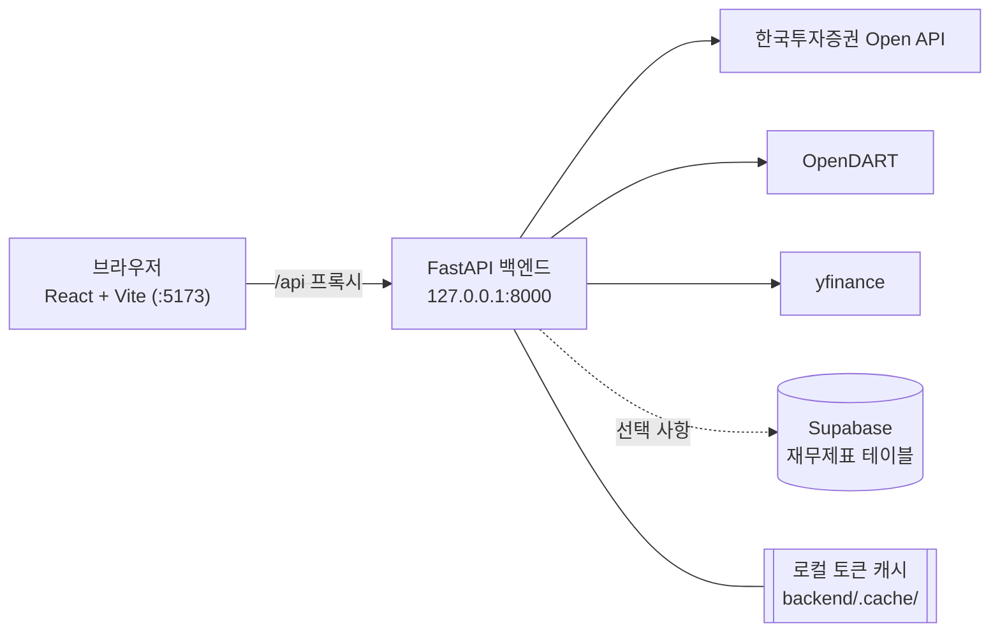
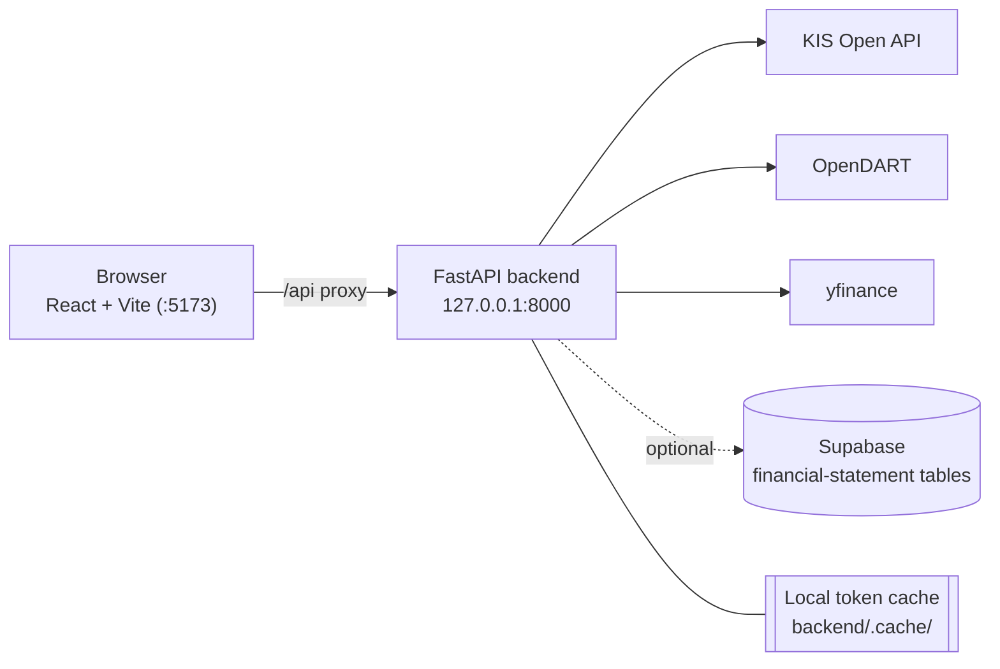

# Custom HTS

**국내·미국 시장을 한 화면에서 분석하는 개인용 웹 HTS**
**A self-hosted web HTS for analysing Korean and US markets in one place**

[](LICENSE)


[한국어](#한국어) · [English](#english)

---

## 한국어

### 소개

Custom HTS는 증권사 HTS(Home Trading System)처럼 시세·차트·재무 정보를 보여 주는 **개인용 웹 애플리케이션**입니다. 여러 곳에 흩어져 있는 데이터를 한 화면에 모읍니다.

- **한국투자증권(KIS) Open API** — 국내 주식·장내채권·선물옵션 시세, 캔들(봉), 호가, 계좌 잔고
- **OpenDART(금융감독원 전자공시)** — 국내 기업 재무제표, 기업 개황, 공시 목록
- **yfinance(Yahoo Finance)** — 미국 주식 시세, 캔들, 재무제표, 밸류에이션

본인 컴퓨터에서 실행하고, **본인의 API 키**로 데이터를 조회합니다. 이 앱은 **조회·분석 전용**이며 주문 기능은 없습니다.

> [!WARNING]
> **면책 조항** — 이 프로젝트는 학습·개인 분석용이며 투자 권유가 아닙니다. 표시되는 데이터와 계산 결과의 정확성·적시성을 보장하지 않으며, 이를 근거로 한 투자 판단의 책임은 전적으로 사용자에게 있습니다. 한국투자증권, 금융감독원, Yahoo와 관련이 없는 비공식 프로젝트입니다. 각 데이터 제공처의 이용약관을 준수하는 것은 사용자의 책임입니다.

### 주요 기능

| 화면 | 기능 |
|------|------|
| **국내주식** | 종목명·코드 검색(KIS 종목 마스터), 현재가·등락, 일/주/월봉과 분봉 캔들 차트, 밸류에이션 지표, 예상실적(컨센서스), DART 재무제표(재무상태표·손익계산서·현금흐름표) |
| **장내채권** | 채권 검색, 시세·호가 기반 수익률, 듀레이션·볼록성 등 위험 지표, 수익률 추이 |
| **선물옵션** | 지수·주식 선물/옵션 검색(마스터), 현재가, 일봉/분봉 캔들 |
| **베이시스** | 선물과 현물(지수·주식) 사이의 베이시스, 베이시스 추이, 풋콜 패리티로 본 선물 이론가 |
| **해외주식** | 미국 주식 시세, 캔들 차트, 재무제표, 밸류에이션 (yfinance) |
| **계좌조회** | 한국투자증권 계좌 잔고와 보유 종목 조회 |

- **API 우선 기능** — 백엔드에는 아직 화면에 연결되지 않은 엔드포인트도 있습니다(선물옵션 호가·옵션 체인, 기업 개황, 공시 목록 등). [API 레퍼런스](docs/API.md)를 참고하세요.
- **등락 색상 관례** — 한국식(상승 빨강 / 하락 파랑)과 글로벌식(상승 초록 / 하락 빨강) 중에서 고를 수 있으며, 선택은 브라우저에 저장됩니다.
- **KIS 접근 토큰 캐시** — 토큰 발급은 1분에 1회로 제한되므로, 발급받은 토큰을 로컬 파일(`backend/.cache/kis_tokens.json`, gitignore 대상)에 저장해 서버를 재시작해도 다시 씁니다.

### 아키텍처



| 영역 | 기술 |
|------|------|
| 프론트엔드 | React 18, TypeScript, Vite, TanStack React Query, Recharts, axios |
| 백엔드 | Python 3.11+, FastAPI, Uvicorn, Pydantic, pandas, httpx/requests, [uv](https://docs.astral.sh/uv/) |
| 데이터 | 한국투자증권 Open API, OpenDART, yfinance, Supabase(선택) |

### 빠른 시작

**준비물**: Python 3.11 이상, [uv](https://docs.astral.sh/uv/), Node.js 20.19 이상(또는 22.12 이상, Vite 7 요구 사항), 그리고 아래 API 키

```bash
git clone https://github.com/shin0105/custom-hts.git
cd custom-hts
cp .env.example .env          # 발급받은 키를 .env에 입력합니다

cd backend && uv sync && cd ..
cd frontend && npm install && cd ..

bash run-dev.sh               # 백엔드(:8000)와 프론트엔드(:5173)를 함께 실행
# 종료: Ctrl+C 또는 bash stop-dev.sh
```

브라우저에서 http://localhost:5173 을 엽니다. API 문서(Swagger UI)는 http://127.0.0.1:8000/docs 에 있습니다.

#### 환경 변수 (`.env`)

| 변수 | 용도 | 발급처 |
|------|------|--------|
| `HANTU_API_KEY`, `HANTU_API_SECRET` | 국내 시세·채권·선물옵션·계좌 | [KIS Developers](https://apiportal.koreainvestment.com/) |
| `HANTU_ACCOUNT_NUMBER` | 계좌조회 (종합계좌번호 앞 8자리) | 한국투자증권 계좌 |
| `HANTU_TOKEN_CACHE_PATH` | (선택) 토큰 캐시 파일 위치 | — |
| `DART_API_KEY` | 국내 재무제표·공시 | [OpenDART](https://opendart.fss.or.kr/) |
| `SUPABASE_URL`, `SUPABASE_KEY` | (선택) 재무제표 저장 테이블 | [Supabase](https://supabase.com/) |

키가 없는 기능만 동작하지 않으며, 미국 주식(yfinance)은 키 없이 사용할 수 있습니다. KIS 키 쌍이 제대로 동작하는지는 `cd backend && uv run python scripts/check_hantu_keys.py`로 확인할 수 있습니다(비밀값은 출력하지 않습니다).

### 프로젝트 구조

```
custom-hts/
├── backend/            FastAPI 백엔드
│   ├── src/
│   │   ├── api/            라우터 (korean, us, financial_statements)
│   │   ├── services/       비즈니스 로직 (시세, 채권 수학, 베이시스, 옵션 패리티 …)
│   │   ├── integrations/   외부 API 클라이언트 (KIS, OpenDART, yfinance, Supabase, 토큰 캐시, 마스터 파일)
│   │   ├── models/         Pydantic 모델
│   │   └── utils/          설정·공통 유틸
│   ├── data/           종목·채권·선물옵션 마스터 데이터
│   ├── scripts/        키 점검, DART 일괄 수집 스크립트
│   └── tests/          pytest 테스트
├── frontend/           React + TypeScript 프론트엔드 (pages, components, services, hooks, theme)
├── database/           Supabase용 재무제표 스키마 (SQL)
├── docs/               문서 (archive/ 는 과거 기록)
├── run-dev.sh          개발 서버 동시 실행
└── stop-dev.sh         개발 서버 종료
```

### 테스트와 점검

```bash
cd backend && uv run pytest        # 일부 테스트는 실제 API 키가 필요합니다
cd frontend && npm run lint && npm run build
```

실제 API를 호출하는 테스트는 결과를 `backend/tests/test-results/`에 저장합니다. 이 폴더에는 계좌 정보가 담길 수 있으므로 gitignore 처리되어 있으며 절대 커밋하지 않습니다. 자세한 내용은 [테스트 실행 가이드](docs/RUNNING_TESTS_LOCALLY.md)를 참고하세요.

### 문서

| 문서 | 내용 |
|------|------|
| [docs/README.md](docs/README.md) | 전체 문서 목차 |
| [설치 가이드](docs/SETUP.md) | 개발 환경 상세 설정 |
| [API 레퍼런스](docs/API.md) | 백엔드 REST 엔드포인트 |
| [한국투자증권 API](docs/KDEVELOPERS_API.md) · [OpenDART](docs/OPENDART_API.md) | 외부 API 연동 방식 |
| [화면 사용 가이드](docs/USER_GUIDE_CHARTS.md) | 화면별 기능과 차트 |
| [CLAUDE.md](CLAUDE.md) · [.github/skills.md](.github/skills.md) | AI 코딩 에이전트용 프로젝트 안내 |

### 보안

- 이 백엔드에는 **인증이 없고** 계좌 잔고를 조회할 수 있습니다. 기본적으로 `127.0.0.1`에만 바인딩하며, 외부 네트워크나 인터넷에 노출하지 마세요.
- `.env`, `backend/.cache/`, `backend/tests/test-results/`는 커밋하지 않습니다(gitignore 처리됨).
- 취약점은 공개 이슈 대신 [SECURITY.md](SECURITY.md)의 방법으로 알려 주세요.

### 기여

이슈와 PR을 환영합니다. [기여 가이드](docs/CONTRIBUTING.md)를 먼저 읽어 주세요. 문서는 한국어를 먼저, 영어를 다음에 쓰는 두 언어 형식을 따릅니다.

### 라이선스

[MIT 라이선스](LICENSE)로 배포합니다. 한국투자증권·OpenDART·Yahoo Finance에서 받은 데이터와 각 서비스의 문서는 이 라이선스에 포함되지 않으며, 각 제공처의 이용약관을 따릅니다.

---

## English

### About

Custom HTS is a **personal web application** that shows quotes, charts and financial data the way a brokerage HTS (Home Trading System) does. It brings data from several sources into a single screen:

- **Korea Investment & Securities (KIS) Open API** — quotes, candles and order books for Korean stocks, exchange-listed bonds and futures/options, plus account balance
- **OpenDART** (Korea's Financial Supervisory Service disclosure system) — Korean company financial statements, company overviews and filings
- **yfinance (Yahoo Finance)** — US stock quotes, candles, financial statements and valuation

You run it on your own machine with **your own API keys**. The app is **read-only**: it has no order placement.

> [!WARNING]
> **Disclaimer** — This project is for learning and personal analysis and is not investment advice. The accuracy and timeliness of displayed data and calculations are not guaranteed, and you alone are responsible for any investment decision based on them. This is an unofficial project with no affiliation to Korea Investment & Securities, the Financial Supervisory Service or Yahoo. You are responsible for complying with each data provider's terms of use.

### Features

| Page | What it does |
|------|--------------|
| **KR stocks** (국내주식) | Search by name or code (KIS stock master), live price and change, daily/weekly/monthly and minute candle charts, valuation metrics, earnings estimates (consensus), DART financial statements (balance sheet, income statement, cash flow) |
| **KR bonds** (장내채권) | Bond search, yields derived from prices and order book, risk metrics such as duration and convexity, yield history |
| **Futures & options** (선물옵션) | Index and single-stock futures/options search (master), current price, daily/minute candles |
| **Basis** (베이시스) | Basis between futures and their underlying (index or stock), basis history, fair futures price implied by put-call parity |
| **US stocks** (해외주식) | US quotes, candle charts, financial statements and valuation (yfinance) |
| **Account** (계좌조회) | Balance and holdings of your KIS account |

- **API-first features** — the backend also has endpoints not yet wired into the UI (futures/options order book and option chain, company overview, disclosure list, …). See the [API reference](docs/API.md).
- **Price-colour convention** — choose the Korean convention (up = red, down = blue) or the global one (up = green, down = red); the choice is saved in the browser.
- **KIS access-token cache** — KIS allows one token issuance per minute, so tokens are stored in a local file (`backend/.cache/kis_tokens.json`, gitignored) and reused across server restarts.

### Architecture



| Layer | Stack |
|-------|-------|
| Frontend | React 18, TypeScript, Vite, TanStack React Query, Recharts, axios |
| Backend | Python 3.11+, FastAPI, Uvicorn, Pydantic, pandas, httpx/requests, [uv](https://docs.astral.sh/uv/) |
| Data | KIS Open API, OpenDART, yfinance, Supabase (optional) |

### Quick start

**Requirements**: Python 3.11+, [uv](https://docs.astral.sh/uv/), Node.js 20.19+ (or 22.12+, required by Vite 7), and the API keys below

```bash
git clone https://github.com/shin0105/custom-hts.git
cd custom-hts
cp .env.example .env          # put your keys in .env

cd backend && uv sync && cd ..
cd frontend && npm install && cd ..

bash run-dev.sh               # runs backend (:8000) and frontend (:5173) together
# stop: Ctrl+C or bash stop-dev.sh
```

Open http://localhost:5173 in your browser. The API docs (Swagger UI) are at http://127.0.0.1:8000/docs.

#### Environment variables (`.env`)

| Variable | Used for | Get it from |
|----------|----------|-------------|
| `HANTU_API_KEY`, `HANTU_API_SECRET` | KR quotes, bonds, futures/options, account | [KIS Developers](https://apiportal.koreainvestment.com/) |
| `HANTU_ACCOUNT_NUMBER` | Account page (first 8 digits of the account number) | Your KIS account |
| `HANTU_TOKEN_CACHE_PATH` | (optional) token-cache file location | — |
| `DART_API_KEY` | KR financial statements and filings | [OpenDART](https://opendart.fss.or.kr/) |
| `SUPABASE_URL`, `SUPABASE_KEY` | (optional) financial-statement storage tables | [Supabase](https://supabase.com/) |

Only the features whose keys are missing stop working; US stocks (yfinance) need no key. To check that your KIS key pair works, run `cd backend && uv run python scripts/check_hantu_keys.py` (it never prints secrets).

### Project layout

```
custom-hts/
├── backend/            FastAPI backend
│   ├── src/
│   │   ├── api/            routers (korean, us, financial_statements)
│   │   ├── services/       business logic (quotes, bond maths, basis, option parity, …)
│   │   ├── integrations/   external API clients (KIS, OpenDART, yfinance, Supabase, token cache, master files)
│   │   ├── models/         Pydantic models
│   │   └── utils/          settings and shared helpers
│   ├── data/           stock / bond / futures-options master data
│   ├── scripts/        key check and bulk DART download scripts
│   └── tests/          pytest tests
├── frontend/           React + TypeScript frontend (pages, components, services, hooks, theme)
├── database/           financial-statement schema for Supabase (SQL)
├── docs/               documentation (archive/ holds historical notes)
├── run-dev.sh          start both dev servers
└── stop-dev.sh         stop the dev servers
```

### Tests and checks

```bash
cd backend && uv run pytest        # some tests need real API keys
cd frontend && npm run lint && npm run build
```

Tests that call the real APIs save their output to `backend/tests/test-results/`. That folder can contain account information, so it is gitignored and must never be committed. See the [test guide](docs/RUNNING_TESTS_LOCALLY.md) for details.

### Documentation

| Document | Contents |
|----------|----------|
| [docs/README.md](docs/README.md) | Index of all docs |
| [Setup guide](docs/SETUP.md) | Detailed development setup |
| [API reference](docs/API.md) | Backend REST endpoints |
| [KIS API](docs/KDEVELOPERS_API.md) · [OpenDART](docs/OPENDART_API.md) | How the external APIs are used |
| [User guide](docs/USER_GUIDE_CHARTS.md) | Pages and charts |
| [CLAUDE.md](CLAUDE.md) · [.github/skills.md](.github/skills.md) | Project guide for AI coding agents |

### Security

- The backend has **no authentication** and can read your account balance. It binds to `127.0.0.1` by default; do not expose it to a network or the internet.
- `.env`, `backend/.cache/` and `backend/tests/test-results/` are never committed (they are gitignored).
- Please report vulnerabilities as described in [SECURITY.md](SECURITY.md), not in a public issue.

### Contributing

Issues and PRs are welcome. Please read the [contributing guide](docs/CONTRIBUTING.md) first. Docs follow a bilingual format: Korean first, then English.

### License

Released under the [MIT License](LICENSE). Data obtained from KIS, OpenDART and Yahoo Finance, and those services' own documentation, are not covered by this license and remain subject to each provider's terms.
